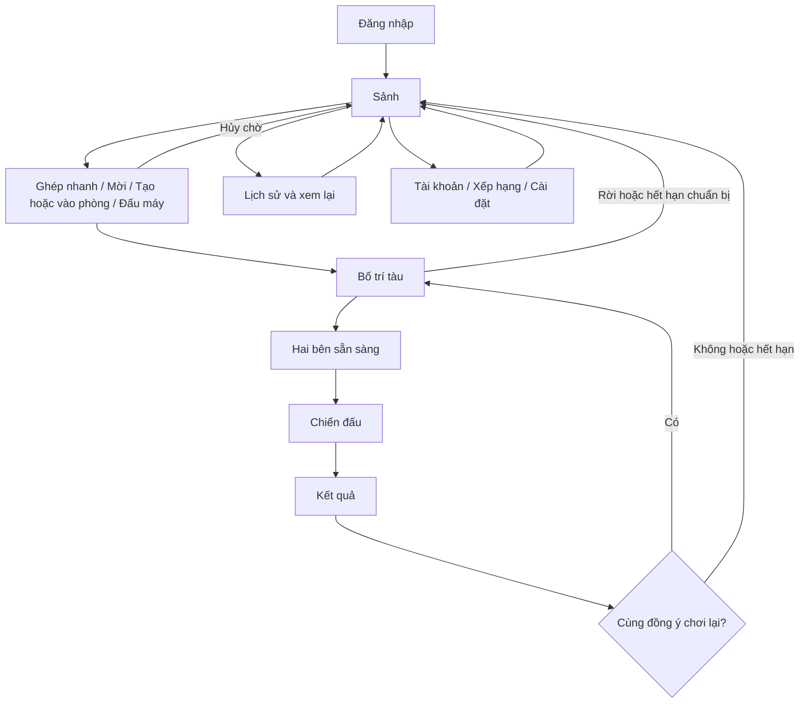

# Kế hoạch hoàn thiện Battleship Online

Ngày lập: **26/10/2026**. Trạng thái: **đã triển khai B0–B6; B7 đã đạt kiểm thử và đóng gói trên Windows, còn nghiệm thu LAN hai máy/macOS**.

Đây là kế hoạch triển khai duy nhất của dự án. Mục tiêu: người chơi hiểu luồng, người đọc hiểu mã nguồn, nhóm kiểm chứng được bản chạy trước khi demo. Bản kế hoạch được cập nhật theo triển khai ngày 26/10/2026. Bằng chứng kiểm thử mới nằm trong TASKS_AND_MEMBERS.md; các mục môi trường chưa có được ghi NOT-RUN.

## 1. Đích đến và phạm vi

1. **Dễ dùng:** mỗi màn hình nói rõ đang ở đâu, đang chờ gì, bước tiếp theo và cách thoát.
2. **Dễ đọc:** giao diện, xử lý mạng, luật chơi và lưu dữ liệu có trách nhiệm rõ; dọn mã tách khỏi thay đổi hành vi.
3. **Đáng tin cậy:** server quyết định trạng thái; lỗi có phản hồi; kết quả kiểm thử và giới hạn được ghi đúng thực tế.

Giữ Java SE, Swing, TCP JSON UTF-8 theo dòng, MySQL (JDBC, driver trong `lib/`) và tương thích API Java 8. Giữ chức năng hiện có, dữ liệu thật, thay đổi đang làm và các báo cáo Word gốc. Không chuyển nền tảng, viết lại toàn bộ, tự commit/push hoặc thử nghiệm trên tài khoản thật.

| Đã có trong mã nguồn | Việc cần hoàn thiện |
| --- | --- |
| Đăng nhập, tự tạo tài khoản tên mới, chặn phiên trùng, xóa tài khoản | Đổi mật khẩu; giải thích rõ hành vi tự tạo tài khoản |
| Tạo/vào phòng, mời, ghép nhanh, đấu máy ba mức | Thống nhất trạng thái chờ, hủy và trở về sảnh |
| Đặt tàu, xếp ngẫu nhiên, Ready/hủy Ready | Giới hạn thời gian chuẩn bị; lưu mẫu bố trí |
| Chiến đấu, timer, xử lý thoát, hình phạt, chơi lại | Rà chuyển trạng thái và lỗi; hiển thị tình trạng kết nối |
| Lịch sử, kết quả hai bàn cờ, phát lại trận | Phân trang, lọc và trạng thái tải/rỗng/lỗi |
| MySQL, chống cộng điểm lặp, thử lưu lại kết quả lỗi | Phục hồi kết quả đã ghi bền vững vào hàng đợi chờ khi restart |
| Chat, cài đặt âm thanh/hiệu ứng, kiểm thử tự động | Giữ hoạt động xuyên suốt các luồng và kiểm thử lại bản cuối |

“Đã có” không đồng nghĩa mọi kiểm thử hiện tại đều đạt. Bằng chứng các lần trước nằm trong TASKS_AND_MEMBERS.md và docs/UPGRADE_VERIFICATION.md.

## 2. Luồng người dùng thống nhất



Nhánh “hết hạn chuẩn bị” là hành vi mới cần triển khai. Chơi lại tạo mã trận mới. Kết quả do đầu hàng/mất kết nối không mở thỏa thuận chơi lại. Tài khoản còn hình phạt vẫn thấy sảnh nhưng bị khóa vào trận đến khi đủ điều kiện.

| Màn hình | Người dùng cần nhìn thấy | Quy tắc chuyển bước |
| --- | --- | --- |
| Đăng nhập | Máy chủ, cổng, tên, mật khẩu, tình trạng kết nối, lỗi dễ hiểu | Chỉ mở sảnh sau xác nhận đăng nhập; kết nối lỗi cho thử lại |
| Sảnh | Hồ sơ, online, bốn cách vào trận và đấu máy | Một người chỉ thuộc một hàng chờ/phòng/trận; đang chờ có nút hủy |
| Bố trí | Tàu còn thiếu, hướng tàu, thời gian chuẩn bị, Ready của hai bên | Đặt tàu thành công rồi mới Ready; hủy Ready được xác nhận mới cho sửa |
| Chiến đấu | Lượt ai, còn bao lâu, ô đang chọn, kết quả phát bắn, tình trạng mạng | Chỉ gửi một phát đang chờ; HIT/SUNK giữ lượt, MISS đổi lượt |
| Kết quả | Thắng/thua, lý do, điểm, trạng thái lưu, hai bàn cờ | Không cộng điểm từ client; chơi lại chỉ khi server cho phép |
| Lịch sử/xem lại | Bộ lọc, danh sách, tải thêm, phát lại | Chỉ đấu thủ của trận được xem chi tiết; trận cũ thiếu replay có giải thích |
| Tài khoản/cài đặt | Đổi mật khẩu, xóa tài khoản, âm thanh/hiệu ứng | Báo thành công sau xác nhận; phân biệt dữ liệu server với tùy chọn máy |

Quy ước chung: gửi mạng có trạng thái chờ; lỗi giữ dữ liệu cần thử lại; thông báo tiếng Việt nhất quán; đóng cửa sổ và nút quay lại đi cùng một đường xử lý. Chat giữ bản nháp khi đổi màn hình trong cùng phiên. Mất kết nối phải dọn phiên cũ và về đăng nhập, không tự hồi sinh trận đã bị server kết thúc.

## 3. Các quy tắc phải giữ

- Bàn 10×10, bộ tàu [5,4,3,3,2], tổng 17 ô; server kiểm tra toàn bộ bố trí.
- Người đi trước ngẫu nhiên; lượt mặc định 15 giây. Hết hạn chỉ mất lượt, không bắn hộ.
- Server là trọng tài; không gửi vị trí tàu còn bí mật của đối thủ trước khi kết thúc trận.
- Thắng online +3, thua bình thường +0. Rời trận đang chạy bị trừ tối đa 3 điểm và khóa ghép 60 giây theo hành vi hiện tại; hạn phạt được lưu. Server chủ động dừng không phạt người chơi.
- Rời/hết hạn khi đặt tàu không tính điểm, số trận hoặc hình phạt. Luyện tập không tác động xếp hạng.
- Mỗi kết quả chỉ được áp dụng một lần theo match_id; rematch dùng phiên và mã trận mới.
- Từ chối đăng nhập trùng, giữ phiên đang chơi. Giữ tự tạo tài khoản khi tên chưa tồn tại và giải thích rõ ở giao diện.
- Giữ JSON theo dòng, trường data, tọa độ x=col, y=row, tên thông điệp hiện hành; thông điệp mới có tài liệu và kiểm thử tương ứng.

Luật đã triển khai xem [GAME_RULES.md](GAME_RULES.md); giao thức xem [NETWORK_PROTOCOL.md](NETWORK_PROTOCOL.md). Quy tắc/bảng test cũ khác hành vi hiện tại phải được đối chiếu và đồng bộ ở B0, không âm thầm thay luật khi dọn mã.

## 4. Thứ tự triển khai

Làm tuần tự **B0 → B1 → B2 → B3 → B4 → B5 → B6 → B7**. Chỉ đánh dấu hoàn thành khi có mã, kiểm thử phù hợp và tài liệu khớp. Các tên lớp mới là gợi ý; không tạo lớp chỉ để giảm số dòng.

| Bước | Kết quả bàn giao | Phụ thuộc |
| --- | --- | --- |
| B0 | Mốc kiểm thử ban đầu và đặc tả nhất quán | Không |
| B1 | Luồng điều khiển và mã nguồn dễ theo dõi | B0 |
| B2 | Đổi mật khẩu và luồng tài khoản rõ ràng | B1 |
| B3 | Đặt tàu có hạn chờ, mẫu bố trí dùng lại | B2 |
| B4 | Tình trạng kết nối và phản hồi chiến đấu rõ ràng | B3 |
| B5 | Lịch sử có phân trang/bộ lọc, replay ổn định | B4 |
| B6 | Kết quả chờ lưu có cơ chế phục hồi | B5 |
| B7 | Kiểm thử toàn luồng, đóng gói và demo | B0–B6 |

### B0 — Chốt hiện trạng trước khi thay đổi

- [x] Đọc .agents/rules/battleship_rules.md, luật/giao thức/kiến trúc và git status; ghi nhận, bảo toàn thay đổi có sẵn.
- [x] Chạy build và kiểm thử hiện tại bằng dữ liệu tạm/cổng riêng. Ghi ngày, môi trường, lệnh, kết quả; phân biệt lỗi đã có với lỗi phát sinh sau sửa.
- [x] Đối chiếu luật thoát/phạt, timeout, rematch giữa mã và tài liệu; sửa mô tả lỗi thời, ví dụ TC-08 còn ghi thoát trận nhận 0 điểm trong khi luật hiện tại có trừ điểm.
- [x] Lập bảng sự kiện theo mục 2: trạng thái đầu → yêu cầu → phản hồi/sự kiện → trạng thái sau → nhánh lỗi. Đặt trong SYSTEM_ARCHITECTURE.md, không tạo kế hoạch phụ.

**Đạt khi:** có mốc kiểm thử thực tế, các bất nhất được xử lý hoặc ghi rõ; không mang lỗi đã sửa trong kế hoạch cũ sang như lỗi hiện tại.

### B1 — Làm rõ luồng xử lý và trách nhiệm mã nguồn

- [x] Chuẩn hóa cách trình bày các lớp điều phối đang dồn nhiều lệnh trên một dòng; tên biến/hàm thể hiện hành động và trạng thái. Không định dạng lại cả dự án trong một lần.
- [x] Rà ClientController: tách nhóm xử lý phiên, sảnh, đặt tàu, chiến đấu, kết quả/lịch sử thành hàm có tên rõ; chỉ tách controller riêng khi trách nhiệm thực sự độc lập. Giữ ChatController chuyên trách chat.
- [x] Có một nguồn trạng thái client nhất quán; cờ “đang chờ” gắn với yêu cầu cụ thể. Tập trung chuyển màn hình và dọn timer/listener/dialog, tránh từng nhánh tự dọn một phần.
- [x] ClientHandler định tuyến/xác thực/phản hồi; manager quản lý nghiệp vụ; MatchSession giữ trạng thái trận; storage phụ trách giao dịch. UI hiển thị và phát ý định người dùng.
- [x] Ghi rõ thứ tự khóa registry → match, kiểm tra phiên/trận/lượt để bỏ sự kiện cũ và ranh giới luồng mạng/EDT. Giữ I/O chặn ngoài EDT, không thêm khóa ngược chiều.
- [x] Sau mỗi lần tách trách nhiệm, chạy hồi quy liên quan; giữ nguyên giao thức và luật chơi trong bước này.

**File chính:** ClientController.java, ClientHandler.java, LobbyManager.java, MatchManager.java, MatchSession.java, SYSTEM_ARCHITECTURE.md.

**Đạt khi:** người đọc lần được nút bấm → gửi yêu cầu → server xử lý → UI cập nhật; các nhánh đã sửa giữ nguyên kết quả kiểm thử.

### B2 — Hoàn thiện tài khoản

- [x] Thêm đổi mật khẩu tại Tài khoản trong sảnh: mật khẩu hiện tại, mới, nhập lại. Không đưa mật khẩu vào thông báo/log.
- [x] Server lấy tài khoản từ phiên xác thực, kiểm tra mật khẩu cũ, chỉ cho đổi khi rảnh ở sảnh. Nếu băm bất đồng bộ, kiểm tra lại trạng thái trước khi ghi.
- [x] Băm bằng cơ chế hiện có; chỉ đổi cache/báo thành công sau commit. Giữ ID, điểm, lịch sử, chat và hạn phạt.
- [x] Bổ sung CHANGE_PASSWORD_REQ/RESP, dữ liệu/mã lỗi tương ứng. Không tự đăng xuất sau thành công; lần đăng nhập tiếp theo dùng mật khẩu mới.
- [x] Chú thích ở đăng nhập: tên chưa tồn tại sẽ tạo tài khoản mới. Giữ xóa tài khoản có xác nhận mật khẩu.

**File chính:** UserManager.java, PasswordHasher.java, StorageManager.java, SqliteStore.java, ClientHandler.java, MessageType.java, ClientController.java và giao diện tài khoản.

**Kiểm chứng:** sai mật khẩu cũ; mới rỗng/quá dài; nhập lại khác; chưa đăng nhập; đang trong trận; lỗi ghi; yêu cầu lặp; đăng nhập bằng mật khẩu cũ/mới sau restart.

**Đạt khi:** thất bại không đổi dữ liệu; đổi mật khẩu thành công không làm mất dữ liệu tài khoản.

### B3 — Hoàn thiện giai đoạn chuẩn bị

- [x] Hạn đặt tàu mặc định **120 giây**, cấu hình riêng với timer chiến đấu; bắt đầu khi tạo phiên PLACING đủ hai bên, áp dụng cả luyện tập và rematch.
- [x] Server gửi deadline/thời gian server; UI đếm ngược, nhắc khi còn 30 giây. Ready/hủy Ready không gia hạn.
- [x] Hết hạn khi chưa bắt đầu thì hủy chuẩn bị, báo lý do, đưa cả hai về sảnh; không tính trận/điểm/phạt. Callback cũ không hủy trận đang chạy hoặc ván mới.
- [x] Hai bên Ready được xử lý trước deadline mới bắt đầu; Ready tại/sau deadline dẫn đến hết hạn dù callback timer chưa chạy. Quyết định nằm trong khóa trạng thái trận.
- [x] Lưu tối đa **5 mẫu bố trí** trên máy theo tài khoản và máy chủ: đặt tên, dùng lại, đổi tên/xóa. Mẫu chỉ chứa bố trí của chính người chơi, không chứa mật khẩu.
- [x] Chỉ áp dụng mẫu khi chưa Ready; kiểm tra trước khi thay bàn. Mẫu lỗi giữ bố trí hiện tại; server vẫn xác nhận hợp lệ khi gửi.

**File chính:** GameConfig.java, MatchSession.java, MatchManager.java, PlacementPanel.java, controller và phần lưu tùy chọn cục bộ.

**Kiểm chứng:** hết giờ khi chưa/một người Ready; Ready sát hạn; rời/mất mạng; chơi lại; hai trận độc lập; mẫu sai/trùng/vượt biên; mẫu còn sau mở app; đổi tài khoản không lẫn mẫu.

**Đạt khi:** không có phiên chuẩn bị chờ vô hạn; mọi đường kết thúc dọn đúng một lần.

### B4 — Làm rõ kết nối và thao tác trong trận

- [x] Dùng heartbeat hiện có đo thời gian khứ hồi bằng đồng hồ đơn điệu, ghép đúng request_id; bỏ mẫu phiên cũ. Không tạo vòng ping độc lập.
- [x] Hiện “Đang đo / Kết nối tốt / Kết nối chậm / Mất kết nối” và ms ở sảnh, đặt tàu, chiến đấu. Ngưỡng hiển thị có cấu hình; mất kết nối dựa trên watchdog, không dựa vào một mẫu ping cao.
- [x] Thể hiện “Đang gửi phát bắn / Đang chờ đối thủ / Đến lượt bạn”; thao tác bị chặn có lý do. Hiệu ứng không chặn sự kiện mạng hoặc kéo dài lượt.
- [x] Mất mạng thì giải phóng phiên, cho kết nối/đăng nhập lại; không tự gửi lại phát bắn hoặc phục hồi trận đã kết thúc. Hình phạt lấy từ server.
- [x] Kết quả phân biệt thắng/thua bình thường, đầu hàng, mất kết nối, chờ lưu; chơi lại chỉ hoạt động khi server cho phép.

**File chính:** SocketClient.java, ServerListener.java, ClientController.java, LobbyFrame.java, PlacementPanel.java, BattlePanel.java, MatchResultView.java.

**Kiểm chứng:** mạng thường/chậm, heartbeat trễ, server dừng, callback phiên cũ, bấm liên tục, bắn sát timeout; UI phản hồi khi mạng không phản hồi.

**Đạt khi:** người chơi biết đang chờ mạng hay đối thủ; trạng thái hiển thị không quyết định luật chơi.

### B5 — Tra cứu lịch sử và xem lại thuận tiện

- [x] Giữ mặc định 20 trận/trang; thêm “Xem thêm”, lọc thắng/thua, đối thủ, khoảng ngày.
- [x] Server lọc trước khi phân trang; sắp ổn định theo thời điểm kết thúc và match_id. Cursor có thứ tự tương ứng; đổi bộ lọc phải tải lại từ đầu, bỏ phản hồi cũ.
- [x] Bổ sung bộ lọc, cursor, has_more vào giao thức, giữ giới hạn frame. Dùng truy vấn MySQL có tham số, tránh tải hết lịch sử chỉ để lấy một trang.
- [x] Ghi rõ múi giờ/khoảng ngày hiển thị, chuyển thành khoảng thời gian gửi server nhất quán. Có trạng thái tải, rỗng, lỗi và thử lại.
- [x] Giữ quyền xem replay chỉ cho đấu thủ; trận cũ thiếu replay vẫn có tóm tắt; xem lịch sử người khác không được mở chi tiết trái quyền.

**File chính:** MatchHistoryDialog.java, MatchReplayDialog.java, ClientController.java, ClientHandler.java, UserManager.java, StorageManager.java, SqliteStore.java.

**Kiểm chứng:** trên 50 trận; trùng thời gian; trận mới xuất hiện giữa hai trang; đổi lọc khi đang tải; kết quả rỗng; người ngoài yêu cầu replay; tài khoản đã xóa.

**Đạt khi:** không bỏ/trùng trận giữa các trang trong cùng phạm vi truy vấn; dữ liệu luôn khớp bộ lọc hiện tại.

### B6 — Bảo vệ kết quả khi lưu thất bại

- [x] Thiết kế hàng đợi kết quả ghi bền vững trước khi áp dụng điểm, ví dụ journal ghi nối tiếp trong thư mục dữ liệu; bản ghi có phiên bản, match_id và đầy đủ kết quả.
- [x] Luồng: ghi và đồng bộ journal xuống đĩa → commit điểm/lịch sử/hạn phạt trong MySQL → đánh dấu hoàn thành/dọn journal an toàn. Giữ chống lặp theo match_id.
- [x] Restart đọc lại kết quả còn chờ; database đã có match_id thì không cộng lại. Nạp trạng thái chặn ghép còn chờ trước khi mở nhận người chơi.
- [x] Journal ghi dở/hỏng được xử lý có kiểm soát, giữ bằng chứng và cảnh báo; không thay bằng dữ liệu mẫu. Không chứa mật khẩu hoặc phát board bí mật ra giao diện/log.
- [x] Nếu cả journal và database không ghi được, báo chưa bảo đảm lưu, giữ thử lại trong RAM, không báo đã lưu. Không hứa phục hồi khi chưa ghi bền vững được ở đâu.
- [x] Có quy trình dừng có kiểm soát, sao lưu/khôi phục cả journal chưa xử lý; giới hạn dung lượng và dọn sau khi chắc chắn commit.

**File chính:** StorageManager.java, SqliteStore.java, MatchManager.java, luồng shutdown; SYSTEM_ARCHITECTURE.md và README.md.

**Kiểm chứng:** crash sau journal/trước commit; sau commit/trước dọn; phục hồi hai lần; lỗi đĩa từng bước; journal ghi dở; hạn phạt qua restart; dữ liệu/chat cũ giữ nguyên. Ca crash dùng tiến trình và dữ liệu thử riêng.

**Đạt khi:** kết quả đã ghi journal bền vững phục hồi đúng một lần; không cộng điểm/phạt lại, không báo thành công sai khi không thể lưu.

### B7 — Nghiệm thu, đóng gói và bàn giao

- [x] Chạy hồi quy sau tích hợp, gồm bot/chat/replay/âm thanh và tình huống mới; kiểm thử timer thật 15 giây và Swing thật.
- [x] Kiểm tra cửa sổ tối thiểu/resize: nút chính không che, chữ không cắt; chat mở/thu gọn không làm mất đường thao tác; hiệu ứng tắt được và dọn khi đổi màn hình.
- [x] Bốn client tạo hai trận độc lập; một trận timeout/ngắt mạng không ảnh hưởng trận kia. Rematch liên tiếp không giữ timer/dialog/phiên cũ.
- [ ] Kiểm thử LAN hai máy vật lý; chạy JAR trên Windows/macOS nếu có máy. Thiếu môi trường ghi NOT-RUN, chưa đạt phần nghiệm thu đó.
- [x] Build JAR cuối; chạy từ thư mục khác bằng dữ liệu tạm và dist/lib/; không đóng gói dữ liệu thật.
- [x] Cập nhật README, luật, giao thức, kiến trúc, UI và bảng kiểm thử; ghi rõ tính năng đã làm, lỗi và giới hạn còn lại.

**Đạt khi:** người khác làm theo README chạy server, nhiều client và chơi trọn luồng; phần chưa kiểm chứng không bị ghi PASS.

## 5. Kiểm thử và ghi tiến độ

Các lệnh hiện có, chạy từ thư mục dự án:

```powershell
powershell -NoProfile -ExecutionPolicy Bypass -File .\compile.ps1
powershell -NoProfile -ExecutionPolicy Bypass -File .\run_tests.ps1
powershell -NoProfile -ExecutionPolicy Bypass -File .\run_tests.ps1 -RealTimer
powershell -NoProfile -ExecutionPolicy Bypass -File .\run_tests.ps1 -Gui -RealTimer
```

Chạy nhóm liên quan sau từng thay đổi, toàn bộ tích hợp ở B7; không cần lặp mọi bộ sau sửa nhỏ. Đăng ký test mới vào runner hiện có. Test dùng thư mục tạm, tài khoản thử, cổng riêng; không sửa data/ thật.

Ghi bằng chứng vào TASKS_AND_MEMBERS.md: **Ngày | Bước | Hành vi | Lệnh/môi trường | PASS/FAIL/NOT-RUN | Bằng chứng hoặc lỗi còn lại**. Kết quả cũ giữ ngày cũ, không dùng thay kiểm thử phiên bản cuối.

| Mốc | Trạng thái |
| --- | --- |
| B0 — Hiện trạng và đặc tả | Hoàn thành và đã kiểm thử |
| B1 — Luồng và mã nguồn | Hoàn thành và đã kiểm thử |
| B2 — Tài khoản | Hoàn thành và đã kiểm thử |
| B3 — Chuẩn bị trận | Hoàn thành và đã kiểm thử |
| B4 — Kết nối và chiến đấu | Hoàn thành và đã kiểm thử |
| B5 — Lịch sử và replay | Hoàn thành và đã kiểm thử |
| B6 — Phục hồi kết quả | Hoàn thành và đã kiểm thử |
| B7 — Nghiệm thu và bàn giao | PASS cục bộ/GUI/JAR; LAN hai máy và macOS NOT-RUN |

## 6. Điều kiện hoàn thành dự án

- [x] B0–B6 hoàn thành, hành vi mới có kiểm thử và không làm hỏng chức năng hiện có.
- [x] Luồng chính, hủy/lỗi/mất mạng có điểm kết thúc rõ; không mắc BUSY do phiên cũ.
- [x] Điểm/lịch sử/hạn phạt nhất quán; phục hồi đúng giới hạn công bố.
- [x] Build, tích hợp, GUI, đóng gói đạt; kết quả LAN/macOS ghi theo kiểm thử thực tế.
- [x] Tài liệu đúng bản chạy, không còn checklist kế hoạch cũ gây nhầm là việc cần làm.

Chưa đưa vào đợt này: kết bạn, khán giả trực tiếp, giải đấu, đổi kích thước bàn/luật bắn, khôi phục trận sau mất mạng, triển khai Internet/TLS, nâng cấp đồ họa lớn. Các phần đó cần đặc tả riêng sau khi bản hiện tại ổn định.

## 7. Cách tiếp tục từ kế hoạch

Khi được yêu cầu triển khai, bắt đầu ở bước chưa hoàn thành đầu tiên. Đọc lại thay đổi thực tế trong workspace, thực hiện từng phần kiểm tra được, cập nhật checklist và bằng chứng. Tạo tài liệu này không có nghĩa đã triển khai tính năng. Nếu thiếu môi trường kiểm chứng, ghi rõ và tiếp tục phần độc lập có thể làm.

## 8. Kết quả triển khai ngày 26/10/2026

Đã hoàn thiện mã client/server cho đổi mật khẩu; hạn đặt tàu 120 giây; 5 mẫu bố trí theo endpoint và ID; độ trễ heartbeat; lịch sử lọc/phân trang; journal phục hồi kết quả và thông báo điểm sau retry. ClientController chia luồng tài khoản/sảnh/đặt tàu/lịch sử/chiến đấu; các lớp điều phối chính được trình bày lại để theo dõi trạng thái.

Kiểm thử tự động thường, timer thật 15 giây, Swing toàn luồng và nhóm giao diện mới đã PASS. Ca crash dùng tiến trình riêng ở hai ranh giới trước/sau MySQL commit; đã kiểm tra không cộng điểm lặp. JAR server chạy từ thư mục tạm, hai người đấu và đọc lịch sử; client nạp từ JAR độc lập đăng nhập thành công. Script Windows tự tìm Java hợp lệ, không phụ thuộc shim Oracle javapath.

LAN hai máy vật lý, macOS thực tế và runtime Java 8: NOT-RUN. API Java 8 được kiểm tra khi biên dịch trên JDK 25.0.1. Soak test dài ngày và mất điện/hỏng đĩa chưa kiểm chứng; không suy ra từ localhost hoặc crash tiến trình.
