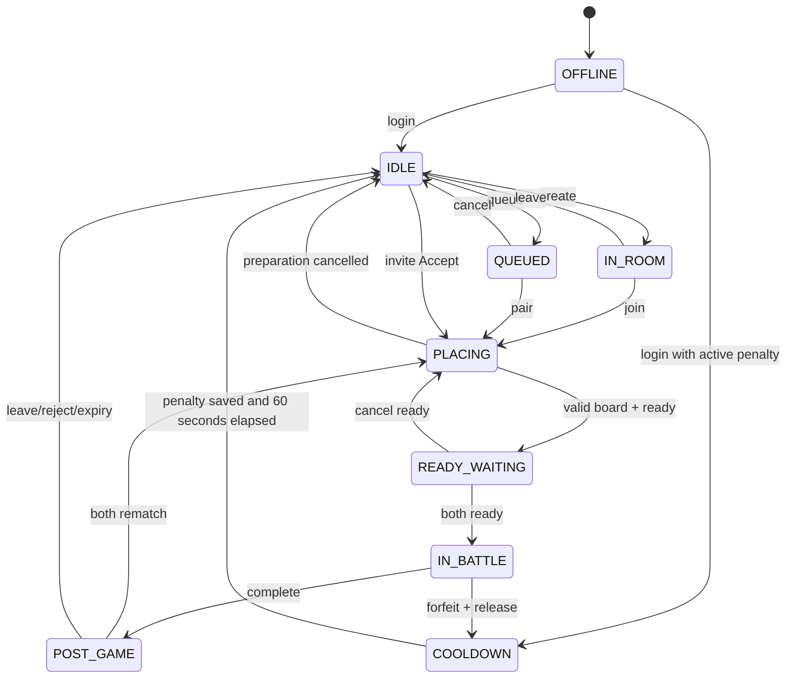

# Kiến trúc Battleship Online

Java SE/Swing, TCP JSON UTF-8 theo dòng, SQLite JDBC cho lưu trữ. Server là trọng tài duy nhất giữ bàn cờ bí mật và quyết định mọi thay đổi. Tài liệu này mô tả kiến trúc đã triển khai; lộ trình hoàn thiện nằm trong [PLAN.md](PLAN.md).

## Cấu trúc

| Module | Lớp chính và trách nhiệm |
| --- | --- |
| Shared | GameConfig; Coordinate/Ship/Board/User/MatchRecord; Message/MessageType/JsonUtil; LineConnection |
| Kết nối | GameServer nhận tối đa 128 connections, worker pool cố định; ClientHandler parse/schema/auth gate/replay request; LineConnection framing, writer queue và watchdog |
| Tài khoản | UserManager đăng nhập nguyên tử, một handler sở hữu user; PasswordHasher PBKDF2 có salt, thuật toán/v1/số vòng trong chuỗi hash; presence snapshot |
| Lobby | LobbyManager room registry, queue, invitation có id/expiry, một thao tác pair dùng chung cho các lối vào trận |
| Trận | MatchManager membership/session registry và scheduler; MatchSession board, Ready, deadline, lượt, kết thúc và rematch agreement |
| Storage | StorageManager import legacy, transaction SQLite accounts+matches, chống lặp theo match ID, pending retry |
| Client | SocketClient quản lý từng generation connection; ClientController state/events; LoginFrame, LobbyFrame, PlacementPanel, BattlePanel, LeaderboardDialog |

## Trạng thái

Connection mất/logout đưa về OFFLINE sau cleanup, giữ hạn phạt nếu rời trận RUNNING. Đối thủ của người rời trận trở về IDLE. Presence công khai IDLE/BUSY/OFFLINE; phase chi tiết QUEUED/IN_ROOM/PLACING/READY_WAITING/IN_BATTLE/POST_GAME/COOLDOWN. COOLDOWN dùng status BUSY. Match có PLACING/RUNNING/FINISHED/CANCELLED. Ready riêng từng người trong PLACING, RUNNING chỉ được vào một lần.

## Khóa và thread

`UserManager.getRegistryLock()` là khóa chung của lobby/match membership. Create/join/pair/queue/Accept/leave/rematch/cleanup dùng khóa này; một user không được đồng thời ở nhiều context. Map membership lấy theo handler, cleanup remove bằng tham chiếu đúng session để không xóa ván mới. Login/logout sở hữu một session được bảo vệ bởi UserManager; logout chỉ remove nếu đúng handler.

MatchSession dùng monitor riêng cho board, Ready, fire, timeout và kết thúc. Thứ tự khi cần cả hai khóa: registry rồi match. Timer không gọi ngược registry trong khóa match; completion callback được đưa vào scheduler để chạy sau khi nhả khóa. Post-game future kiểm tra phiên cũ, được hủy khi release/rematch. Scheduler hai thread thuộc MatchManager/server, remove-on-cancel; shutdown thu hồi scheduler, workers, listener và toàn bộ sockets.

Không ghi socket đồng bộ trong khóa nghiệp vụ. Event được serialize thành snapshot trong khóa rồi offer vào hàng đợi connection theo thứ tự; writer riêng thực hiện I/O. Queue đầy hoặc lỗi ghi chỉ đóng socket đó. Watchdog kiểm tra idle và write đang bị chặn bằng nanoTime. Socket đóng trước khi reader thu hồi; cleanup qua một đường idempotent cho logout, EOF, watchdog và lỗi ghi.

Match deadline dùng đồng hồ đơn điệu, turn_id tăng mỗi hành động hợp lệ/timeout. Callback giữ lượt lúc tạo và bị bỏ nếu lượt đã thay. Clock epoch/nano, Random và scheduler có thể inject trong constructor MatchSession để kiểm thử ranh giới mà không phụ thuộc sleep.

## Lưu dữ liệu

`SqliteStore` là adapter JDBC cho `data/battleship.db`; `StorageManager` giữ giao diện nghiệp vụ và cache tài khoản/kết quả. Mỗi lần ghi mở connection ngắn, prepared statements và một transaction accounts+matches; chỉ cập nhật RAM sau commit. Bật synchronous=FULL, secure_delete=ON và busy timeout. match_id duy nhất chống ghi lặp. Các kiểm thử lỗi ghi vẫn inject tại writeSnapshot (tên giữ tương thích test, hiện thực ghi SQL).

Lần đầu nhập JSON cũ trong một transaction, giữ ID/hash/điểm/lịch sử/hạn phạt. Marker schema_version chỉ được ghi sau nhập thành công; khởi động sau dùng SQLite. JSON nguồn được giữ nguyên, không ghi tiếp. Mật khẩu là PBKDF2-HMAC-SHA256 có salt. Xóa tài khoản yêu cầu xác thực lại, chỉ ở sảnh; transaction bỏ username/hash, ẩn danh tên trong lịch sử. Một tombstone theo ID duy trì tham chiếu lịch sử và không xuất hiện trong login/xếp hạng.

Hạn phạt rời trận là endedAt+60000, trừ min(3, điểm). Pending chưa lưu vẫn chặn ghép; retry không kéo dài hạn phạt. ResultJournal ghi từng kết quả vào file tạm, đồng bộ FileDescriptor rồi atomic move sang file chính; SQLite commit xong mới dọn journal. Khởi động đọc/kiểm tra phiên bản và SHA-256, nạp pending trước khi mở socket và thử commit theo match_id. Journal hỏng giữ nguyên và dừng khởi động; file tạm chưa công bố chỉ được báo, không tự áp dụng. Nếu chưa ghi journal được, kết quả chỉ nằm trong RAM và chưa bền vững. File DB và mọi bản lưu cũ chứa thông tin nhạy cảm cần được quản lý như dữ liệu tài khoản.

## Máy chơi

BotClient là kết nối ảo có ID âm, dùng cùng MatchSession và scheduler với người thật. BotBrain chỉ nhận tọa độ/kết quả bắn công khai; không tham chiếu Board đối phương. EASY ngẫu nhiên, MEDIUM săn ô xen kẽ/ô kề, HARD tính mật độ vị trí tàu hợp lệ. Timer bắn kiểm tra lại session và turn_id trước khi hành động; rời trận/chơi lại/shutdown hủy thao tác cũ. Luyện tập không commit điểm/lịch sử xếp hạng và không áp dụng hình phạt.

## Client và bí mật bàn cờ

Socket connect có timeout 5 giây, reader/heartbeat/writer nằm ngoài EDT. Gửi trên EDT chỉ enqueue; disconnect đóng bất đồng bộ. Mỗi connection có generation, callback cũ bị bỏ ngay ở EDT boundary. Controller bỏ request response đã xử lý và event không thuộc match hiện tại; rematch có previous_match_id để kiểm tra chuyển phiên.

Placement chờ PLACE_SHIPS_RESP rồi Ready; Ready khóa click, cancel chờ ack. Battle chỉ gửi một phát đang chờ, mở lại sau TURN_CHANGE hoặc lỗi bắn; đồng hồ tính từ deadline server trên nanoTime cục bộ, không tự xử thắng/đổi lượt. Game-over và invite dialog không chặn event; invitation tự đóng khi hết hạn. Khi rời/đổi màn hình/mất kết nối, dừng Swing Timer, bỏ listener và đóng dialog/cửa sổ cũ.

Server chỉ phát kết quả ô đã bắn và tọa độ tàu đã chìm, không phát board chưa lộ của đối thủ. Log không in password/hash hoặc traffic chứa board bí mật. TLS không nằm trong phạm vi triển khai hiện tại.

## Lưu trữ và luồng chat

`ClientHandler` định tuyến `CHAT_SEND_REQ`, `CHAT_HISTORY_REQ`, `CHAT_CONVERSATIONS_REQ` đến `ChatManager`. User ID của người gửi/đọc lấy từ session đã đăng nhập. Gửi tin dùng khóa registry để không chuyển nhầm event sang tài khoản khác khi logout/login; mọi truy cập database đi qua monitor của `StorageManager`. Nội dung chỉ gửi tới handler của người nhận, không đi qua broadcast.

`SqliteStore` tự thêm bảng `chat_messages` và index khi mở database hiện có; giữ nguyên bảng tài khoản và kết quả. Cột: `message_id` tự tăng, `sender_id`, `recipient_id`, `body`, `sent_at_ms`, `client_message_id`, `pair_low`, `pair_high`. Unique `(sender_id,client_message_id)` chống lưu trùng, index `(pair_low,pair_high,message_id)` phục vụ lịch sử. Transaction lưu tài khoản/trận không xóa tin nhắn. Mọi giá trị dùng prepared statement; chỉ trả ACK và event sau commit thành công.

Lịch sử chỉ truy vấn cặp `(current_user,peer_id)`, lấy 21 hàng để trả 20 hàng + `has_more`, sắp ID tăng dần phía response. Danh sách 100 cuộc trò chuyện gần nhất chỉ thuộc current user. Không giữ bản sao tên cũ trong bảng tin nhắn: query join accounts, hiển thị tên ẩn danh nếu tài khoản đã xóa. Nội dung tin cũ giữ cho người còn lại, ID người dùng không tái sử dụng.

Client có `ChatController` riêng cho mỗi lần đăng nhập. Cache theo peer và ID tin, tránh trùng khi history và event đến xen kẽ; draft và pending request tách theo cuộc trò chuyện. `ChatPanel` được gắn vào layered pane của cửa sổ hiện tại, thu gọn còn thanh tiêu đề và không thay đổi layout bản đồ. Không block EDT để chờ mạng. Đăng xuất/mất kết nối tháo overlay và xóa cache phiên. Tin chưa đọc là trạng thái của phiên client; lịch sử nội dung nằm trong SQLite, không phụ thuộc cache này.

## Phân công và kiểm chứng

Dương: TCP/xác thực/presence; Bảo: room/queue/invitation; Hải: board/placement/Ready; Khoa: combat/timer/kết quả/xếp hạng. Protocol, storage và tích hợp phối hợp chung. Xem TASKS_AND_MEMBERS.md cho ánh xạ nguồn Word và test, README.md cho chạy/demo và giới hạn đã kiểm chứng.

## Luồng sự kiện của bản hoàn thiện 26/10/2026

| Trạng thái đầu | Ý định/yêu cầu | Server xử lý | Trạng thái sau và nhánh lỗi |
| --- | --- | --- | --- |
| LOGIN | LOGIN_REQ | Xác thực/tạo mới, giữ chủ phiên cũ | LOGIN_RESP thành công → LOBBY; lỗi giữ form |
| LOBBY | CHANGE_PASSWORD_REQ | Registry lock → kiểm tra phase → storage xác thực/băm/commit | Giữ LOBBY và phiên; chỉ cập nhật hash RAM sau commit |
| IDLE | Queue/mời/tạo/vào phòng/đấu máy | Registry bảo đảm một context | QUEUED/IN_ROOM hoặc PLACING; lỗi giữ trạng thái server |
| PLACING | PLACE_SHIPS_REQ → PLAYER_READY_REQ | Match lock, thời hạn chuẩn bị, validate board tạm | Ready ack khóa sửa; hai Ready hợp lệ trước hạn → RUNNING |
| PLACING | Hết hạn/rời phòng | CANCELLED, callback ra ngoài match lock rồi registry release | Cả hai LOBBY, không tính điểm/phạt |
| RUNNING | FIRE_REQ | Kiểm tra match/turn/deadline, bắn và đổi/giữ lượt | FIRE_RESULT/TURN_CHANGE; lỗi không đổi deadline/count |
| RUNNING | Hết tàu/đầu hàng/mất kết nối | FINISHED, journal → SQLite → cập nhật RAM | MATCH_END, điểm/trạng thái lưu; pending thì khóa rematch |
| FINISHED | Retry lưu thành công | Commit đúng một lần, dọn journal, broadcast thống kê | RESULT_SAVED_NOTIFY cập nhật điểm/nút nếu còn cùng trận |
| POST_GAME | Hai bên chấp nhận rematch | Registry thay phiên cũ bằng phiên và mã mới | PLACING với deadline chuẩn bị mới |
| LOBBY | GET_MATCH_HISTORY_REQ | SQL có bộ lọc/cursor, mỗi trang ≤50 | MATCH_HISTORY_RESP; controller chỉ nhận request mới nhất |
| Mọi màn hình | Heartbeat/mất mạng | Watchdog transport và cleanup theo phase | Cập nhật ms hoặc về LOGIN; không tự hồi sinh trận |

ClientController định tuyến sau kiểm tra request/phiên sang handleAccountMessage, handleLobbyMessage, handlePlacementMessage, handleHistoryMessage và handleBattleMessage. Screen là trạng thái màn hình, không thay phase nghiệp vụ do server quyết định. ChatController giữ riêng luồng chat. Rời màn hình đặt tàu/chiến đấu dừng đồng hồ, hiệu ứng và listener liên quan.

SocketClient gửi heartbeat có request_id, giữ mốc nanoTime và chỉ đo phản hồi khớp trong cùng generation. Callback về EDT được kiểm tra generation lần nữa; không dùng ping để đổi lượt hoặc xử thắng/thua.

Lịch sử dùng SQLite với chỉ số theo player1/player2, thời điểm kết thúc và match_id. Cursor mang bộ lọc/tài khoản, mốc rowid của trang đầu và khóa cuối; bản ghi thêm sau mốc không chen vào các trang đang tải. Upsert giữ rowid kết quả cũ. Response chỉ gồm tóm tắt; fleets/shot log đi qua endpoint chi tiết có kiểm tra đấu thủ.

Mẫu tàu dùng Preferences, tối đa 5 ô cho mỗi SHA-256(endpoint + accountId); lưu bố trí của chính mình, không lưu credentials. FleetLayout kiểm tra và sao chép đầy đủ trước khi thay bàn đang sửa; server tiếp tục validate yêu cầu đặt tàu.

Journal giới hạn 64 MiB/1 MiB mỗi bản ghi, chống lặp bằng match_id đã commit. Retry/restart không kéo dài hạn phạt. Kiểm chứng là crash tiến trình sau khi journal được công bố; không tuyên bố chịu mọi tình huống mất điện/hỏng đĩa. Shutdown hủy trận đang chạy trước khi đóng socket và thử lưu pending lần cuối.
